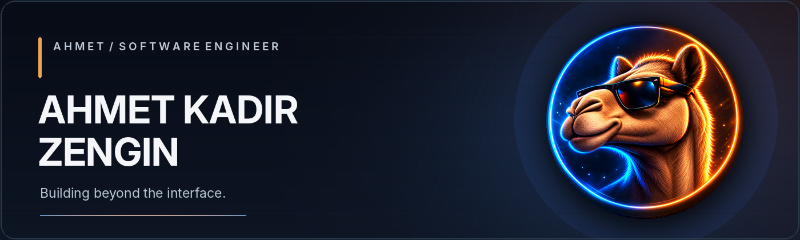

  

 

I’m **Ahmet Kadir Zengin**, a software engineer working across **full-stack applications, AI & multi-agent systems, software architecture, and desktop/mobile development**. I enjoy building reliable software with thoughtful interfaces — from industrial testing applications to experimental engineering tools.

I also explore **game development** and reusable gameplay systems.

**[Portfolio](https://www.ahmetkadirzengin.com/)** · **[LinkedIn](https://www.linkedin.com/in/ahmetkadirzengin/)** · **[Projects](https://www.ahmetkadirzengin.com/projects)**

---

### Selected work

| Project | What it explores |
| :--- | :--- |
| **AI-HQ** | Modular multi-agent software engineering, orchestration, and reusable knowledge. |
| **UTEST Software Platform** | Industrial testing interfaces, real-time measurements, reporting, and cross-platform delivery tooling. |
| **Game-Forge** | Modular systems and tooling for configurable game development. *In development.* |
| **CamelBot** | Community automation and integrations across platforms. |

## Technical Focus

###  Web & Applications
TypeScript, JavaScript, React, Next.js, REST APIs, WebSockets

###  Systems & Desktop
C#, .NET, Electron, Avalonia, desktop and release tooling

###  AI & Game Development
Multi-agent architectures, evaluation workflows, Unity, interactive applications

---

### Background

- **Software Engineer**, UTEST · industrial application interfaces and engineering tools.
- **Previously**, Cerebrum Technologies · Android and Unity application development.
- **B.Sc. in Software Engineering**, Atılım University.
- **Languages:** Turkish (native) · English (C2).

---

  Engineering, interfaces, and the systems behind them.

